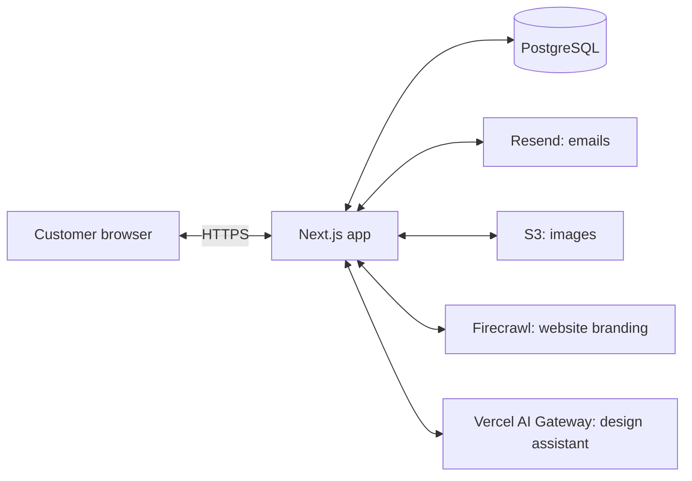

# Notes for the reviewer

Everything in the brief is in: logo and background uploads, background colour, text colour and size, up to two guest fields, Connect button colours, and a live preview on desktop, tablet and mobile. These notes cover how I thought about it.

## The idea

I wanted it to feel like approving a designer's work, not editing a page. A Wi-Fi login page is a chore for most venues, so the app does the design up front and the customer just picks one. The full editor is there if they want to tweak it.

I'd also let people use it for free and send them a finished design even if they didn't ask. It costs us almost nothing, and a page they can already see sells itself.

## Getting started in seconds

The customer types their website address and gets three finished designs (Minimal, Event and Corporate) using their own name, logo, colours and an image from their site. They pick one and they're done. Anything the site doesn't have falls back to the template, so a design never looks broken.

## Designing by chat

The editor has a design assistant beside the canvas. The customer describes their event ("navy and gold for the footy grand final, ask for name and phone"), or picks an example prompt, and the page changes as the answer streams in. Follow-up messages change only what was asked. They can also start from their own brand: From your website reads their site, and Upload assets takes a logo and a photo.

It writes the same settings the controls do, checked against the same schema, so everything it makes stays editable by hand. A reply is one undo step, and stopping or a failed reply puts the page back as it was.

## Sign-in with a magic link

No passwords. When a rental is booked, we email the customer a link to their designs. Clicking it signs them in. Links expire and work once, and they can ask for a new one any time.

## Infrastructure

One Next.js app hosts the editor, the API and the published pages. The MVP runs without any of the services on the right: designs are saved in the browser, and branding is read by a small built-in fetcher. The design assistant is the exception: it needs an AI Gateway key, though the rest of the editor works without one.

## Database

Six tables, in [`schema.sql`](schema.sql): `customers`, `rentals`, `magic_links`, `sessions`, `designs` and `assets`. A design's settings are stored as one JSON column, the same shape the editor already validates.

## The code

It's a Turborepo monorepo. That's more than a demo strictly needs, but it's how I like to work, and it makes it easy to add apps later (an admin console, say) that reuse the same pieces.

- `apps/web`: the editor
- `packages/portal`: the page settings, templates and the renderer that draws the page. The editor, previews and published page all use the same renderer, so what you see is what guests get.
- `packages/ui`: shared shadcn/ui components

The editor's colours are design tokens in [`apps/web/app/globals.css`](../apps/web/app/globals.css), so re-theming it means changing one file. The customer's branding only ever styles their page, never the editor.

## Working with AI agents

I set the repo up so coding agents have the context they need without being told each time:

- [`AGENTS.md`](../AGENTS.md) holds the rules, commands and architecture, plus the product spec in [`.scratch/editor/spec.md`](../.scratch/editor/spec.md) beside the feature specs in [`.scratch/`](../.scratch/).
- Skills in `.agents/skills/` cover test-driven development, module design, React best practices and PR writing.
- An agent must pass `lint`, `check-types` and `test` before a change counts as done. Custom lint rules check the comment style, imports between packages and no hard-coded colours.
- Hooks stop an agent writing long comments or reading huge generated files.
